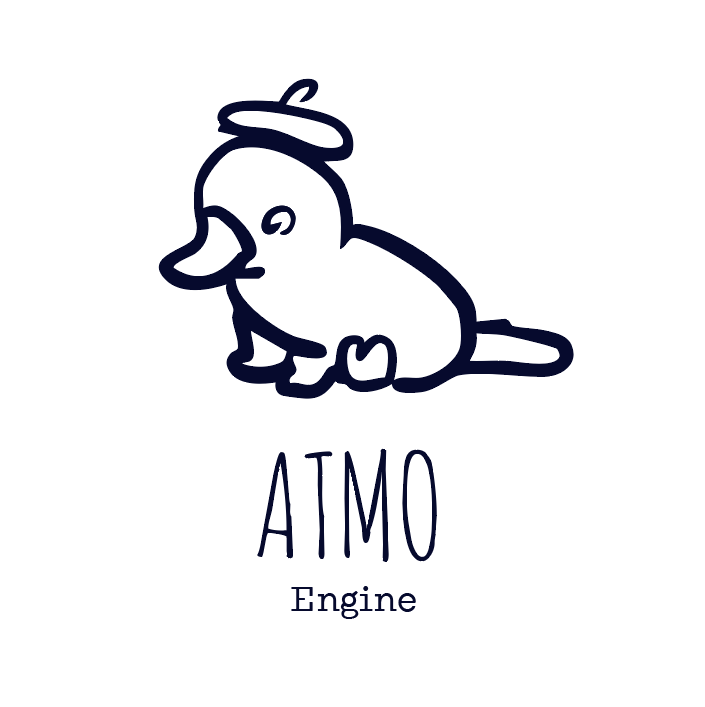

<p align="center">
  
</p>

<h1 align="center">ATMO Engine</h1>

<p align="center">
  A lightweight C++23 game engine for 2D games, with an Entity Component System, Luau scripting and a built-in editor.
</p>

<p align="center">
  <a href="https://github.com/ATMO-Engine/atmo/actions/workflows/build.yml"></a>
  <a href="https://docs.atmo-engine.com"></a>
  <a href="LICENSE"></a>
  <a href="https://crowdin.com/project/atmo-engine"></a>
</p>

<p align="center">
  <a href="https://docs.atmo-engine.com/latest/getting-started/">Getting started</a> ·
  <a href="https://docs.atmo-engine.com/latest/manual/">Manual</a> ·
  <a href="https://docs.atmo-engine.com/latest/api/cpp/">C++ API</a> ·
  <a href="CONTRIBUTING.md">Contributing</a>
</p>

---

## Features

- **Entity Component System** built on [Flecs](https://www.flecs.dev/), with scenes, 2D entities, cameras and sprites.
- **Luau scripting**: attach [Luau](https://luau.org) scripts to entities to drive gameplay.
- **Built-in editor** with scene, material and texture editors.
- **Modern rendering**: Metal on macOS, Vulkan on Windows and Linux, on its own render thread, with HiDPI and pixel-art scaling.
- **Custom shaders** written in [Slang](https://shader-slang.org) for sprites and post-processing, recompiled when you save them.
- **2D physics** with [Box2D](https://box2d.org): static, dynamic and kinematic bodies.
- **UI** with [Clay](https://github.com/nicbarker/clay), and **networking** through TCP and UDP entities.
- **Addons** that can ship native C++ libraries with access to the engine's core systems.
- **Export** games with a lightweight runtime that leaves the editor out.

## A taste of scripting

```lua
function Update(deltaTime)
    local transform = this:getTransform()
    if transform == nil then return end

    if Input.isPressed("D") then
        transform.position.x = transform.position.x + 100 * deltaTime
    end
end
```

## Quick start

You need [xmake](https://xmake.io/guide/quick-start.html) and a C++23 compiler: MSVC on Windows, clang++ on macOS, g++ on Linux.

```sh
git clone https://github.com/ATMO-Engine/atmo.git
cd atmo
xmake
xmake run atmo
```

The first build downloads and compiles every third-party library, so it takes a while; later builds reuse them.
Linux needs a few system development packages first.
See [Building from source](https://docs.atmo-engine.com/latest/getting-started/building-from-source) for the full setup, build options and test targets.

## Platforms

| OS      | Compiler | Rendering           |
|---------|----------|---------------------|
| Windows | MSVC     | Vulkan              |
| macOS   | clang++  | Metal (Vulkan opt-in) |
| Linux   | g++      | Vulkan              |

Machines without a supported GPU can still run the engine with `--headless`.
See [Rendering platforms](https://docs.atmo-engine.com/latest/manual/rendering) for requirements.

## Documentation

The documentation lives at **[docs.atmo-engine.com](https://docs.atmo-engine.com)**, versioned with the engine:

- [Getting started](https://docs.atmo-engine.com/latest/getting-started/): building the engine and finding your way around.
- [Manual](https://docs.atmo-engine.com/latest/manual/): architecture, rendering, screen sizes, shaders and materials.
- [C++ API reference](https://docs.atmo-engine.com/latest/api/cpp/): generated from the source comments.

The guides and manual are written in [`docs/`](docs/), next to the code they describe; the site itself is built by [ATMO-Engine/docs](https://github.com/ATMO-Engine/docs).

## Contributing

Contributions are welcome. Please read [CONTRIBUTING.md](CONTRIBUTING.md) before opening an issue or a pull request.

Want to help translate the engine? Join the project on [Crowdin](https://crowdin.com/project/atmo-engine); see the [Translations](CONTRIBUTING.md#translations) section of the contributing guide.

## Authors

ATMO Engine is developed by a community of voluntary contributors.
See [AUTHORS.md](AUTHORS.md) for the founders, main contributors and translators.

## License

ATMO Engine is released under the [MIT License](LICENSE).
It includes third-party software with separate licenses; see [THIRD_PARTY_LICENSES](THIRD_PARTY_LICENSES).
